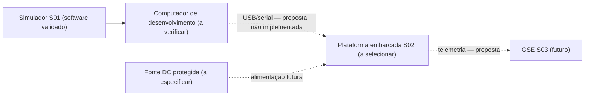

# S00 — topologia conceitual e matriz de interfaces

**Estado:** arquitetura-alvo em preparação; **nenhuma conexão física validada**.

## Topologia de referência

**Nota:** setas tracejadas representam interfaces **não verificadas**.
O S01 atual funciona localmente em Python e não depende de S02 ou GSE.

## Matriz de interfaces propostas

| ID | Origem → destino | Tipo proposto | Dados a verificar antes do uso | Estado |
|---|---|---|---|---|
| IF-01 | Computador → plataforma de bancada | USB ou serial | Modelo do adaptador, isolamento, driver, níveis lógicos e pinagem | Não selecionada |
| IF-02 | Fonte → plataforma de bancada | Alimentação DC | Tensão, limites de corrente, polaridade, proteções e conector | Não selecionada |
| IF-03 | Plataforma → periférico de sensor (eventual) | I²C/SPI/UART, conforme componente | Tensão lógica, pull-ups, protocolo, pinagem, compatibilidade | Fora do primeiro ensaio |
| IF-04 | Receptor/GSE → arquivos de dados (futuro) | Interface de software | Esquema de dados, timestamps e origem | Planejada em S03 |
| IF-05 | Sistema → cadeia de métricas (futuro) | Software | Esquema de instrumentação, rótulos e limites | Planejada em S04 |

## Critérios para tornar uma interface verificável

- Identificar endpoints reais por fabricante/modelo e função.
- Conferir níveis elétricos, tensões, tolerâncias, referência de terra,
  proteções e sentidos de sinal nas documentações correspondentes.
- Publicar um diagrama elétrico ou pinagem revisado quando houver
  conexão elétrica.
- Registrar inspeção e teste executado com a identificação do ensaio,
  antes de declarar a interface validada.

Este documento não autoriza conexão direta entre pinos de níveis
desconhecidos, nem testes com rede elétrica ou emissões RF.

[Requisitos](REQUIREMENTS.md) · [Inventário](INVENTORY.md) · [Riscos](RISK-REGISTER.md)
